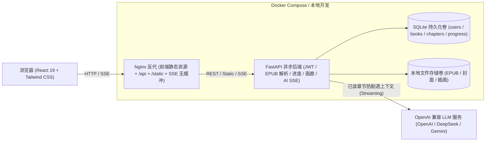

# 私人轻小说文库 · Light Novel Library

一个前后端分离、极简纯白设计风格的私人云端轻小说书架与沉浸式阅读器。支持本地 `.epub` 异步解析、3D 书脊横向书架、三种翻书模式、JWT 多用户数据隔离、云端阅读进度精准恢复、按需开启的防剧透插画画廊，以及严守已读进度边界的流式 AI 轻小说伴读助手。

---

## 核心亮点功能

- **极简纯白 3D 书架**
  - 纯白黑白灰克制视觉，书本以 2:3 实体文库本比例 3D 侧向紧密排布在极简搁板上；
  - 悬停时当前书本平滑转正并微微上浮，左右相邻书籍自动向两侧让位，展示完整封面、阅读进度条与快捷删除入口；
  - 支持全屏拖拽批量导入 `.epub`、按书名/作者实时搜索，以及「最近阅读 / 最近上传 / 书名」三态排序。
- **高保真 EPUB 轻小说解析**
  - 后台异步解析元数据、章节正文、封面图及全书插画，自动清洗 `<script>` 等危险标签；
  - 完整保留轻小说特色的 `<ruby>/<rt>` 注音排版，并将常规 `` 与日版常见的 `<svg><image>` 插画统一提取到本地静态目录。
- **三种翻书模式 + 正文插画灯箱**
  - 支持 **纵向滚动 (`scroll`)**、**横向平移分页 (`slide`)**、**仿真 3D 翻页 (`flip`)** 三种模式一键云端切换；
  - CSS 多栏自动分页适配窗口缩放、字号调整与插画加载，首末页翻页自动无缝衔接上下章；
  - 内置纯白 / 羊皮纸 / 暗夜三套主题、字号调节、抽屉目录与正文插画点击全屏放大预览。
- **JWT 多用户隔离与云端进度同步**
  - 基于 Argon2 密码哈希与 HS256 JWT 实现用户注册/登录与严格的个人书架隔离；
  - 切章立即上报、滚动 1.5s 防抖静默同步、关闭页面 `keepalive` 兜底上报；重新打开自动恢复章节与精确滚动/页码位置。
- **按需开启的防剧透插画画廊**
  - 默认关闭以保持界面极致纯净，可在书架偏好设置中随时开启并云端同步；
  - 自动对当前阅读进度之后章节的插画施加高斯模糊防剧透遮罩（支持点击临时解锁），已解锁插画支持全屏灯箱与 `←` / `→` / `Esc` 快捷键浏览。
- **防剧透 AI 伴读助手（SSE 流式输出）**
  - 后端 SQL 硬性截断至当前已读章节（`order_index <= current`），杜绝任何未读剧情泄露；
  - 阅读器右侧极简抽屉一键生成 **前情提要**、**出场角色卡**，并支持针对已读内容的 **防剧透自由问答**；
  - 原生兼容 OpenAI / DeepSeek / Gemini 等所有标准 OpenAI Chat Completions 协议端点，支持 SSE 流式打字机渲染与随时停止。

---

## 技术栈

| 层级 | 技术选型 |
| --- | --- |
| **前端** | React 19 (TypeScript) · Vite · Tailwind CSS v4 · React Router v6 · Axios · Lucide React |
| **后端** | Python 3.12 · FastAPI · SQLAlchemy 2.0 (Async) · SQLite (`aiosqlite`) · Pydantic v2 |
| **EPUB 与媒体** | `ebooklib` · `beautifulsoup4` · `lxml` · `Pillow` |
| **认证与 AI** | `pwdlib[argon2]` · `PyJWT` · `httpx` (Async SSE Streaming) |
| **部署** | Docker · Docker Compose · Nginx (SPA + REST/Static/SSE 反向代理) |

---

## 系统架构



---

## 界面预览

> 可将实际运行截图放入 `docs/screenshots/` 后替换下方占位图：

| 极简纯白 3D 书架 | 沉浸式阅读器（三种翻书模式） |
| --- | --- |
|  |  |

| 防剧透插画画廊 | 防剧透 AI 伴读助手 |
| --- | --- |
|  |  |

---

## 目录结构

```text
light-novel-web/
├── .env.example                 # 环境变量模板（复制为 .env 使用）
├── docker-compose.yml           # 前后端一键容器编排
├── README.md
├── backend/
│   ├── Dockerfile
│   ├── requirements.txt
│   ├── storage/                 # 本地 EPUB、封面与插画目录（.gitignore 忽略）
│   └── app/
│       ├── main.py              # FastAPI 入口、CORS、StaticFiles、lifespan
│       ├── core/                # config.py / database.py / security.py
│       ├── models/              # user.py / book.py / reading_progress.py
│       ├── schemas/             # auth.py / book.py
│       ├── api/v1/              # auth.py / books.py
│       └── services/            # epub_parser.py / ai_service.py
└── frontend/
    ├── Dockerfile
    ├── nginx.conf               # 生产环境 Nginx 配置（含 SSE 无缓冲反代）
    ├── vite.config.ts
    └── src/
        ├── api/                 # client.ts / auth.ts / books.ts
        ├── context/             # AuthContext.tsx / useAuth.ts
        ├── components/          # BookShelf / BookSpine / PaginatedChapterView / IllustrationGalleryModal / InlineImageLightbox / AIAssistDrawer
        └── pages/               # LoginPage.tsx / HomeShelf.tsx / ReaderView.tsx
```

---

## 快速开始

### 方式一：Docker 一键部署（推荐）

1. 复制环境变量模板并按需修改配置：
   ```bash
   cp .env.example .env
   ```
   编辑 `.env`，至少修改 `JWT_SECRET_KEY` 为随机强密钥；如需启用防剧透 AI 助手，填写 `LLM_API_KEY`、`LLM_BASE_URL` 与 `LLM_MODEL`。

2. 构建并启动容器：
   ```bash
   docker compose up -d --build
   ```

3. 浏览器访问：
   - 应用首页：http://localhost:8080 （端口可通过 `.env` 中的 `APP_PORT` 修改）
   - 数据持久化：SQLite 数据库保存在命名卷 `light_novel_db`，EPUB 与插画保存在命名卷 `light_novel_storage`，重建容器不会丢失用户账号与藏书。

4. 常用运维命令：
   ```bash
   docker compose logs -f backend    # 查看后端日志
   docker compose down               # 停止并移除容器（保留持久化数据卷）
   ```

---

### 方式二：本地开发运行

#### 环境要求
- Python `3.11+`
- Node.js `20+` 与 npm

#### 1. 配置环境变量
复制根目录 `.env.example` 为 `.env` 并填入你的配置（不填 `LLM_API_KEY` 也可正常使用除 AI 助手外的全部功能）。

#### 2. 启动后端（端口 `8000`）
```powershell
cd backend
python -m venv .venv
.\.venv\Scripts\Activate.ps1
pip install -r requirements.txt
uvicorn app.main:app --reload --host 127.0.0.1 --port 8000
```
- 接口文档：http://127.0.0.1:8000/docs

#### 3. 启动前端（端口 `5173`）
```powershell
cd frontend
npm install
npm run dev
```
- 浏览器访问：http://localhost:5173 （Vite 已配置 `/api` 与 `/static` 代理转发至 `127.0.0.1:8000`）。

---

## 环境变量说明（`.env`）

| 变量名 | 必填 | 默认值 | 说明 |
| --- | --- | --- | --- |
| `APP_PORT` | 否 | `8080` | Docker 部署时前端 Nginx 暴露的宿主机端口 |
| `JWT_SECRET_KEY` | 建议填写 | 开发默认值 | JWT 签名密钥，生产环境务必替换为高强度随机字符串 |
| `JWT_ACCESS_TOKEN_EXPIRE_MINUTES` | 否 | `10080`（7 天） | 登录 Token 有效期（分钟） |
| `LLM_API_KEY` | 启用 AI 时必填 | 空 | OpenAI / DeepSeek / Gemini 等模型服务 API Key |
| `LLM_BASE_URL` | 否 | `https://api.openai.com/v1` | OpenAI 兼容接口 Base URL（如 `https://api.deepseek.com/v1`） |
| `LLM_MODEL` | 否 | `gpt-4o-mini` | 模型名称（如 `deepseek-chat`、`gemini-2.5-flash`） |
| `LLM_MAX_CONTEXT_CHARS` | 否 | `24000` | 发送给 AI 的已读章节纯文本最大字符预算 |
| `DATABASE_PATH` | 否 | `backend/light_novel.db` | SQLite 数据库文件路径（Docker 内自动设为 `/app/data/light_novel.db`） |
| `STORAGE_DIR` | 否 | `backend/storage` | EPUB 与插画存储目录（Docker 内自动设为 `/app/storage`） |

---

## License

MIT
